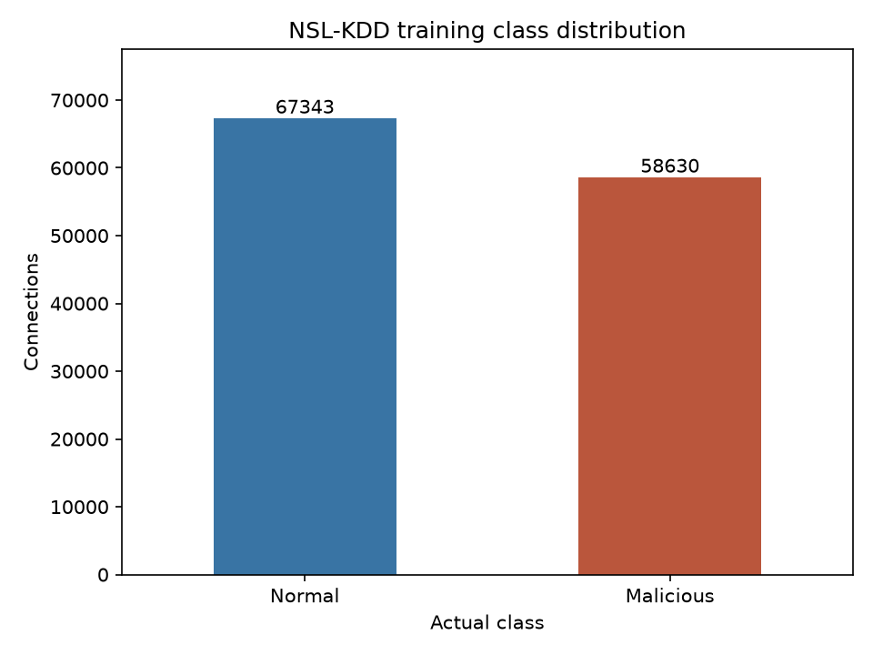

# network intrusion detection with NSL-KDD

## what i wanted to find out

say a company sets an alert for transfers over 10 GB. a scheduled 20 GB backup would raise it every night. a malicious 8 GB transfer would go through without an alert. rules are still useful when the team knows the signature to look for. i wanted to see how much a model could pick up from a few details together, like the service, duration and bytes transferred.

## data and prep

i used the two splits that come with NSL-KDD. there were 125,973 training rows and 22,544 test rows. each row describes one connection. i checked both files for duplicate rows, missing values and non-finite numbers. those checks passed, so i kept the rows as supplied.

i kept all 41 measured features and left out the label and difficulty score. the label is the answer, and difficulty is specific to the benchmark. for the target, normal is 0 and any attack is 1. i gave each protocol, service and flag value its own indicator. i scaled the numeric columns using the training data and applied the same transformations to the test data. [dataset and paper](../README.md#dataset-attribution)



there were 67,343 normal connections and 58,630 malicious ones in training. that's why the majority baseline predicts normal every time.

## what i ran

i started with the majority baseline to see what accuracy looked like without using any connection details. then i used logistic regression since it's a simple way to give each feature a weight and turn the combined score into a probability.

i also tried a single linear layer in PyTorch with the same prepared features. it ran for 10 epochs with binary cross-entropy and AdamW. both models used a cutoff of 0.5. [executed notebook](../deliverables/train.ipynb)

```python
logistic.fit(X_train, y_train)
logistic_predictions = logistic.predict(X_test)
matrix = confusion_matrix(y_test, logistic_predictions, labels=[0, 1])
```

scikit-learn finished in 159 solver iterations. in PyTorch, the average training loss went from 0.1840 in the first epoch to 0.0762 in the tenth.

## what the results showed

| model | accuracy | precision | recall | F1 |
| --- | ---: | ---: | ---: | ---: |
| majority baseline | 43.08% | 0.00% | 0.00% | 0.00% |
| scikit-learn logistic regression | 75.37% | 91.75% | 62.33% | 74.23% |
| PyTorch linear classifier | 75.23% | 91.80% | 62.03% | 74.03% |

the baseline raised zero alerts, so its precision is undefined and shown as zero. with scikit-learn, 7,999 of the 8,718 alerts were correct. that still leaves 719 false alarms for someone to look through. it also missed 4,834 of the 12,833 malicious connections. that's the part i'd pay most attention to before using it on a real network.


PyTorch caught about the same share of malicious connections. scikit-learn took 4.13 seconds with preprocessing included. PyTorch took 4.99 seconds after preprocessing. that's one CPU run, and the two timings cover different work.

## how i'd try it on a company network

i'd have a network sensor summarize connections and send those summaries to the model. flagged connections would go to the SIEM for someone to review. i'd leave the firewall blocking policy alone while checking how many alerts are useful. i'd also check what the sensor can actually see. it may have byte counts and duration, but no login outcomes.

a new app can change what normal traffic looks like. i'd watch for that kind of drift by tracking feature values and what analysts find when they review alerts. if someone deliberately manipulates the input, i'd check the sensor data and look for the same activity in another source. i'd also measure scoring time, queue size and dropped records when traffic spikes.

NSL-KDD gave me a fixed split for comparing the models. before using either one, i'd test it on recent traffic from the actual network and check whether the team can keep up with the alerts.
