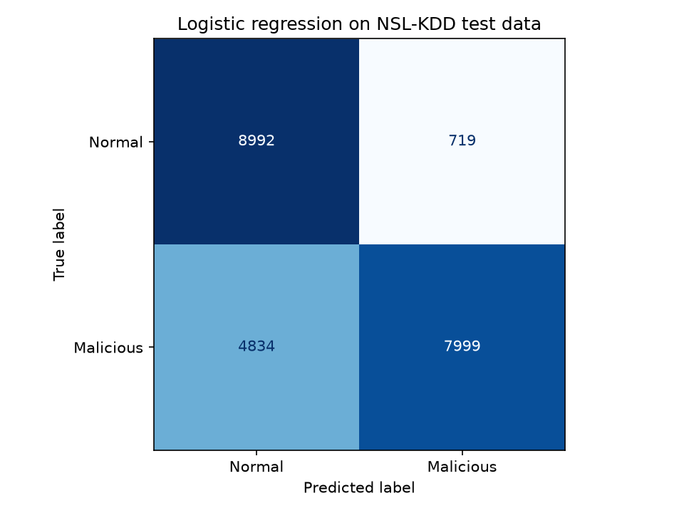

# Machine learning intrusion detection on NSL-KDD

## Why flag network connections?

Suppose a company sets an alert for transfers over 10 GB. A scheduled 20 GB backup would trigger it every night, while a malicious 8 GB transfer would slip through. Rules still make sense for known signatures. For this experiment, the question was whether a model could use several details together, such as the service, connection duration, and bytes transferred, to flag connections for an analyst to review.

## Data and preprocessing

NSL-KDD provides 125,973 training rows and 22,544 test rows. The training split contains 67,343 normal and 58,630 malicious connections. The notebook found zero duplicate full rows and no missing or non-finite values, so it kept the supplied partitions without imputation or row removal. It removed the target label and the benchmark difficulty score from the inputs and kept all 41 measured features. It mapped normal to 0 and every attack category to 1.

Protocol, service, and flag are unordered categories, so the notebook one-hot encoded them. It standardized the remaining features to make their scales comparable during fitting. It learned the encoding and scaling exclusively on the training split. [Dataset and paper attribution](../README.md#dataset-attribution)


Normal is the majority training class, which explains why the baseline always predicts normal.

## Models

The simplest thing to try was predicting the most common training label for every connection. That gave us a baseline. Logistic regression then gave each feature a learned weight and used the combined score to estimate the probability of a malicious connection.

The scikit-learn model was fit once using the supplied training split. The CPU PyTorch comparison uses the same training-fitted transformations and a single linear output trained for ten epochs with binary cross-entropy and AdamW. Both classify at a probability cutoff of 0.5. [Executed notebook](../deliverables/train.ipynb)

```python
logistic.fit(X_train, y_train)
logistic_predictions = logistic.predict(X_test)
matrix = confusion_matrix(y_test, logistic_predictions, labels=[0, 1])
```

The scikit-learn solver used 159 iterations. PyTorch mean training loss fell from 0.1840 in epoch one to 0.0762 in epoch ten.

## Test results

| Model | Accuracy | Precision | Recall | F1 |
| --- | ---: | ---: | ---: | ---: |
| Majority baseline | 43.08% | 0.00% | 0.00% | 0.00% |
| Scikit-learn logistic regression | 75.37% | 91.75% | 62.33% | 74.23% |
| PyTorch linear classifier | 75.23% | 91.80% | 62.03% | 74.03% |

The majority baseline raised zero alerts, so the table reports its undefined precision as zero. With scikit-learn, 7,999 of the 8,718 alerts were correct. An analyst would still have to look through 719 false alarms. The bigger issue was what the alert queue never showed. The model missed 4,834 of the 12,833 malicious connections.



PyTorch gave almost the same result, with recall about 0.3 percentage points lower. The scikit-learn fit took 4.13 seconds including preprocessing. PyTorch training took 4.99 seconds after preprocessing. Those numbers describe one CPU run with different timing boundaries.

## Deployment and limitations

On a company network, a sensor would summarize connections and send them to the model. Flagged connections would go to the SIEM with enough detail for an analyst to investigate. During a trial, the firewall could stay in its usual mode while analysts check the alerts. The first practical question is whether the sensor even sees the fields the model expects. A flow-only sensor may have byte counts and duration, for example, but no login outcomes.

New applications and network migrations can cause concept drift. Track feature distributions and analyst-reviewed outcomes. Validate sensor inputs and corroborate uncertain alerts across independent sources to reduce risk from intentionally manipulated inputs. For scalability, measure feature extraction and scoring latency under peak throughput and track queues and dropped records.

The historical NSL-KDD split supports a reproducible model comparison. Production adoption would require evaluation on current, representative traffic, including how often malicious connections occur and how many alerts analysts can review.
